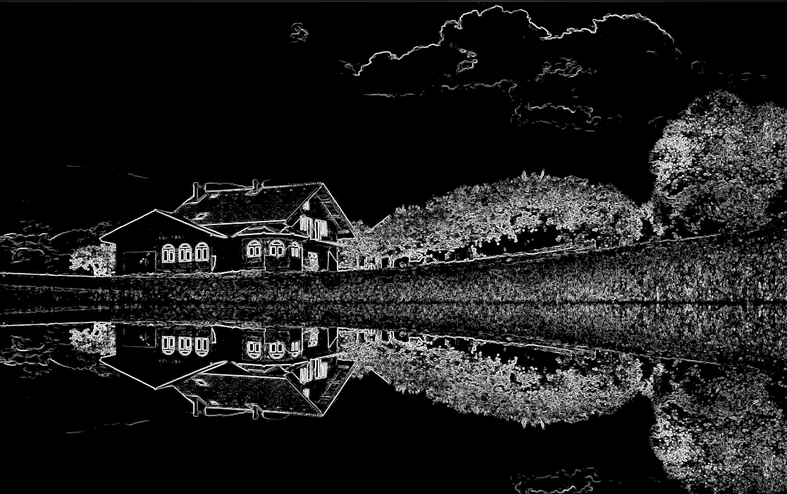
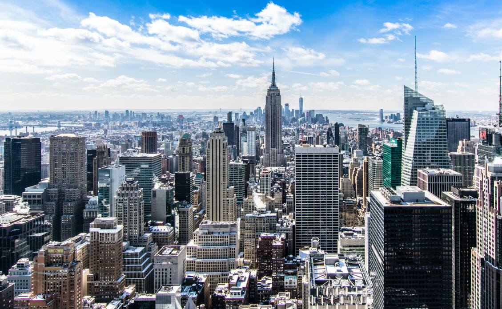
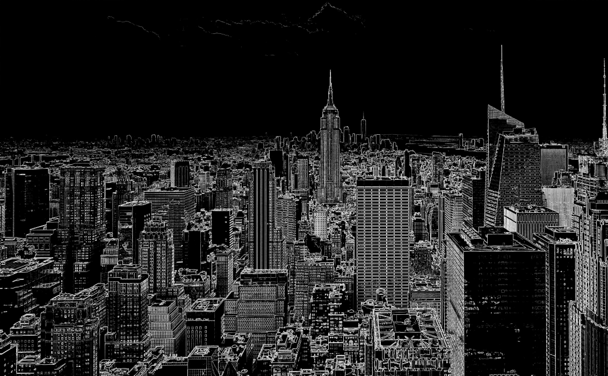

# Parallel Edge Detection Framework

An OpenMP-based C implementation of an image edge-detection pipeline. It converts color images to grayscale, reduces noise with a 5x5 Gaussian blur, computes an adaptive threshold, and applies the Sobel operator. The blur and Sobel stages use 16x16 tiles; independent image work is parallelized with OpenMP.

**Course:** CS-437, Parallel Programming  
**Contributors:** Aneeba Zafar (CS_22029), Bareera Ahsan (CS_22030), Iqra Jawad (CS_22034)  
**Instructor:** Dr. Urooj Ainuddin

## Requirements

- GCC or MinGW-w64 GCC with OpenMP support
- `stb_image.h` and `stb_image_write.h` in the source directory or on the compiler's include path. These headers are required but are not currently included in this folder.

## Build

Run from the directory containing `sobel.c` and the STB headers.

**Linux/macOS:**

```sh
gcc sobel.c -o sobel -fopenmp -lm
```

**Windows with MinGW-w64:**

```powershell
gcc sobel.c -o sobel.exe -fopenmp -lm
```

## Run

**Linux/macOS:**

```sh
./sobel input.jpg edges.png 4
```

**Windows PowerShell:**

```powershell
.\sobel.exe input.jpg edges.png 4
```

The arguments are the input image path, output PNG path, and number of OpenMP threads, in that order. The program prints image dimensions, per-stage timings, total runtime, and the computed adaptive threshold. The saved output is a single-channel PNG.

## Processing Pipeline

1. **Grayscale conversion:** Convert color pixels using luminance weights; single-channel inputs are used directly.
2. **Gaussian blur:** Apply a 5x5 kernel to reduce image noise.
3. **Adaptive threshold:** Compute Sobel gradient magnitudes over the image interior and derive a threshold from their mean.
4. **Sobel edge detection:** Calculate horizontal and vertical gradients, suppress values below the threshold, and clamp edge magnitudes to 255.

The implementation uses OpenMP parallel loops, a reduction for threshold calculation, 16x16 tiling for the blur and Sobel stages, and SIMD directives for inner pixel loops. Border pixels are copied from the input to each corresponding stage.

## Benchmark Results

The following timings are from the project report and are provided for comparison. Times are in seconds. Speedup is relative to the two-thread run for the same image; results may vary with hardware, compiler, and build settings.

### Test Case 1: House with Lake Reflection

High-texture scene with grass, trees, roof and window edges, and reflection symmetry. Reported input: `input.jpg` (5833 x 3620); adaptive threshold: **75**.

<table>
  <tr><th>Input image</th><th>Sobel edge map</th></tr>
  <tr>
    <td></td>
    <td></td>
  </tr>
</table>

| Threads | Grayscale (s) | Gaussian (s) | Threshold (s) | Sobel (s) | Total (s) | Speedup |
| ---: | ---: | ---: | ---: | ---: | ---: | ---: |
| 2 | 0.134 | 1.289 | 0.365 | 0.384 | 2.172 | 1.00x |
| 4 | 0.078 | 0.880 | 0.192 | 0.158 | 1.308 | 1.66x |
| 8 | 0.061 | 0.663 | 0.148 | 0.144 | 1.016 | 2.14x |

### Test Case 2: NYC Skyline

Dense urban architecture with strong contrast between buildings, sky, and clouds. Reported input: `input1.jpg` (2832 x 4240); adaptive threshold: **18**.

<table>
  <tr><th>Input image</th><th>Sobel edge map</th></tr>
  <tr>
    <td></td>
    <td></td>
  </tr>
</table>

| Threads | Grayscale (s) | Gaussian (s) | Threshold (s) | Sobel (s) | Total (s) | Speedup |
| ---: | ---: | ---: | ---: | ---: | ---: | ---: |
| 2 | 0.110 | 0.976 | 0.262 | 0.204 | 1.552 | 1.00x |
| 4 | 0.065 | 0.500 | 0.108 | 0.122 | 0.795 | 1.95x |
| 8 | 0.062 | 0.457 | 0.095 | 0.089 | 0.703 | 2.21x |

### Test Case 3: White Sports Car

High contrast between the body and shadows, with fine mechanical details around the grille, headlights, mirrors, and splitter. Reported input: `input2.jpg` (2560 x 1600); adaptive threshold: **60**.

<table>
  <tr><th>Input image</th><th>Sobel edge map</th></tr>
  <tr>
    <td></td>
    <td></td>
  </tr>
</table>

| Threads | Grayscale (s) | Gaussian (s) | Threshold (s) | Sobel (s) | Total (s) | Speedup |
| ---: | ---: | ---: | ---: | ---: | ---: | ---: |
| 2 | 0.031 | 0.334 | 0.085 | 0.072 | 0.522 | 1.00x |
| 4 | 0.013 | 0.173 | 0.039 | 0.044 | 0.269 | 1.94x |
| 8 | 0.020 | 0.122 | 0.026 | 0.027 | 0.195 | 2.68x |

## Scalability Summary

| Image | 2 threads | 4 threads | 8 threads |
| --- | ---: | ---: | ---: |
| House | 1.00x | 1.66x | 2.14x |
| NYC Skyline | 1.00x | 1.95x | 2.21x |
| White Sports Car | 1.00x | 1.94x | 2.68x |

Across these reported runs, the Gaussian blur is the most time-consuming stage. The best measured speedup is 2.68x for the sports-car image at eight threads.